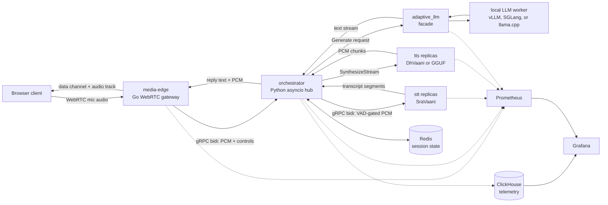

# Inference Orchestrator

Self-hosted, real-time voice inference system for a full-duplex browser agent.
The system accepts microphone audio over WebRTC, detects user turns, transcribes
speech, routes completed turns to a local LLM, synthesizes replies, and streams
agent audio back to the browser with barge-in support.

This README describes the system and its architecture. Setup and run
instructions live in [SETUP.md](SETUP.md).

## System Overview

The repository is organized around five runtime services plus local development
infrastructure:

| Component | Role |
| --- | --- |
| [media-edge](media-edge/README.md) | Browser-facing WebRTC gateway, Opus decode/encode, VAD, barge-in, and playback drain signaling. |
| [orchestrator](orchestrator/README.md) | Async pipeline hub that owns session state, turn assembly, backend routing, interruption, and telemetry emission. |
| [stt](stt/README.md) | SraVaani speech-to-text service exposed through a model-neutral gRPC streaming API. |
| [adaptive_llm](adaptive_llm/README.md) | Local LLM facade that selects a compatible model runtime and exposes a stable Generate API. |
| [tts](tts/README.md) | DhVaani or GGUF/MioTTS speech synthesis service that turns LLM text into PCM audio. |
| [avatar](avatar/README.md) | Optional AVTR-1 talking-head service: renders lip-synced H.264 video from the agent and microphone audio the edge streams to it. |
| [monitoring](monitoring/README.md) | Prometheus, ClickHouse, and Grafana observability stack for service health, saturation, and session traces. |
| [pipeline_test](pipeline_test/README.md) | WAV-based end-to-end harness that drives the real WebRTC edge without a browser. |

Redis stores live logical session state and conversation history. ClickHouse is
an append-only telemetry sink for development and performance analysis. Docker
Compose can run the whole containerized stack, but the primary local development
flow runs the five inference services as host processes and uses Docker for
infrastructure.

## Architecture



The media path is deliberately split by runtime. Go handles WebRTC and
packet-level work at the edge. Python owns orchestration and ML integration.
The boundaries between services are gRPC contracts under [proto](proto/), which
let the model backends change without changing the browser or orchestration
interfaces.

## Turn Lifecycle

The orchestrator is the authority for conversational turns because it is the
only service that sees STT, LLM, TTS, cancellation, and session state together.
Every downstream reply message is stamped with a `turn_id`, so late output from
an interrupted turn cannot be mistaken for the next turn.

The client-facing lifecycle is:

| Signal | Direction | Meaning |
| --- | --- | --- |
| `USER_SPEECH_STARTED` | edge to orchestrator | Edge VAD detected speech and barge-in should cancel active agent work. |
| `END_TURN` | edge to orchestrator to STT | Edge VAD detected enough silence to finalize the user turn. |
| `AGENT_TURN_STARTED` | orchestrator to edge | The orchestrator committed to answering this user turn. |
| `AGENT_TURN_ENDED` | orchestrator to edge | No more text or audio will be produced for this turn. |
| `PLAYBACK_COMPLETE` | edge to browser | Agent audio for the turn has drained or was interrupted. |

The browser gates its speaking indicator and microphone state on
`PLAYBACK_COMPLETE`, not `AGENT_TURN_ENDED`, because the edge may still have
audio buffered after the orchestrator has queued the final frame.

## State and Telemetry

Redis is the source of truth for logical session state. It stores session
metadata, bounded event streams, coordination state, and completed
user/assistant turns. It does not store PCM audio, WebRTC peers, gRPC streams,
or live model handles.

ClickHouse stores immutable pipeline events and session summaries for analysis.
Telemetry writes are asynchronous and lossy by design: a slow telemetry sink
must not block live audio, STT, LLM, or TTS work. Prometheus scrapes each
service's metrics endpoint for saturation and health signals, and Grafana
combines Prometheus and ClickHouse views.

## Scaling Model

Phase 3 added host-process supervision and hardware-aware replica planning.
`scripts/run_pipeline.py` detects CPU, memory, and GPUs, computes STT/TTS
replica counts and thread budgets, launches the five pipeline services, writes
Prometheus file-discovery targets, and circuit-breaks replicas that crash-loop.

The orchestrator fans out across STT and TTS replicas with bounded queues.
Adaptive LLM remains a singleton facade in the standard topology because it
fronts one local model worker with its own admission control and compatibility
checks. The default Docker Compose deployment uses service containers with
Redis, ClickHouse, Prometheus, and Grafana.

## Repository Layout

```text
adaptive_llm/   Local LLM facade, planning, engines, prompts, and tests
avatar/         Optional AVTR-1 avatar video service
docker/         Per-service Dockerfiles
docs/           Product, deployment, load, and performance notes
media-edge/     Go WebRTC gateway
monitoring/     Prometheus, ClickHouse, Grafana dashboards, and alerts
orchestrator/   Python routing hub and session/telemetry code
pipeline_test/  WAV-to-WebRTC end-to-end test harness
proto/          Shared gRPC contracts
scripts/        Proto generation, host-process launcher, orchestration planner
stt/            SraVaani STT service
tts/            DhVaani/GGUF TTS service
```

Key design rationale is recorded in [DECISION.md](DECISION.md). Docker-specific
deployment notes are in [docs/DOCKER.md](docs/DOCKER.md).
