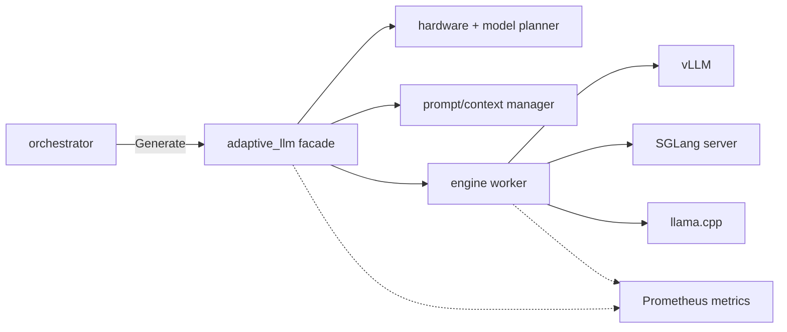

# Adaptive LLM Service

`adaptive_llm` is the local language-model facade for the voice pipeline. It
exposes the stable `llm.v1.Llm/Generate` gRPC API to the orchestrator while
hiding model selection, engine compatibility, prompt rendering, context-window
management, and worker admission control behind the service boundary.

Setup and run instructions live in [SETUP.md](SETUP.md).

## Responsibilities

- Select a local model from `LLM_MODEL_REF`, `LLM_MODEL_ID`, or the model cache.
- Check hardware compatibility and memory headroom before startup.
- Pick the runtime engine: vLLM, SGLang, or llama.cpp.
- Render versioned prompts and structured conversation history.
- Enforce tokenizer-aware input/output token budgets.
- Bound concurrent and queued generation requests.
- Report facade and worker metrics to Prometheus.

## Architecture



The orchestrator always talks to the same gRPC contract. Engine-specific logic
is contained under `adaptive_llm/engines/`, while hardware and model selection
live under `adaptive_llm/planning/`.

## Runtime Model

The facade starts one local worker for the selected model/runtime combination.
For Hugging Face models, the normal path is vLLM when compatible. SGLang can be
selected for models or experiments that benefit from its radix prefix cache.
GGUF models can go to either vLLM or llama.cpp: vLLM serves a single-file GGUF
and usually wins on a CUDA GPU, while llama.cpp covers CPU-only inference,
partial GPU offload, and sharded files. See
[docs/VLLM_GGUF.md](docs/VLLM_GGUF.md).

The worker owns final prompt rendering because it owns the tokenizer and chat
template. The orchestrator sends structured user and assistant turns; the worker
removes the oldest complete pairs until the request fits the context budget,
then truncates only the current user input if no history remains.

## Compatibility and Capacity

Startup checks are intentionally strict. The service should fail early when a
requested model, dtype, engine, or GPU capability is incompatible. This keeps
bad placements from showing up later as false performance data.

Admission control sits at the facade boundary. Requests beyond the configured
in-flight and queued limits are rejected instead of building an unbounded LLM
queue inside the voice path.

## Layout

```text
adaptive_llm/
  chat/          Prompt catalog and context-window logic
  core/          Service config, logging, and runtime manager
  engines/       vLLM, SGLang, llama.cpp worker implementations
  planning/      Hardware detection, compatibility, registry, and planner
  proto/         Generated Python gRPC bindings
  tests/         Planner, engine, prompt, and facade tests
  tools/         Tuning and benchmark helpers
  run.sh         Environment-aware launcher
  main.py        gRPC service entrypoint
```
