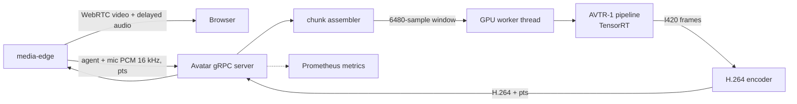

# Avatar Service

`avatar` gives the voice agent a face. It exposes `avatar.v1.Avatar/Stream`
over gRPC, receives the agent's speech and the user's microphone audio from
media-edge, renders a talking head with [AVTR-1](https://github.com/avaturn-live/avtr-1),
and returns H.264 video that the edge sends to the browser on a WebRTC track.

The service is optional. With `EDGE_AVATAR_TARGET` unset the pipeline is
audio-only and behaves exactly as it does without this directory.

Setup and run instructions live in [SETUP.md](SETUP.md).

## Responsibilities

- Load the AVTR-1 pipeline, its TensorRT engines, and the configured portraits.
- Cut each session's audio timeline into the overlapping chunks the model needs.
- Render 25 fps video, 5 frames (200 ms) per chunk.
- Encode frames to H.264 (NVENC, with libx264 as fallback).
- Stamp every frame with its position on the edge's audio timeline.
- Bound concurrent sessions and skip chunks rather than fall behind real time.
- Report render time, drops, and session metrics to Prometheus.

## Architecture



The avatar is a peer of media-edge, not of the orchestrator. The edge already
holds both audio streams, owns the playout clock they have to be synchronised
against, and owns the peer connection the video leaves on. The orchestrator
does not know the avatar exists.

## Timeline and Lip-Sync

The edge sends one 20 ms frame per playout tick, silence included, each stamped
with its position on a per-session timeline. Video frames come back stamped on
the same timeline.

AVTR-1 cannot draw a frame until it has heard about 400 ms past it: each call
takes a 6480-sample window (405 ms) and produces video for the first 200 ms.
The edge therefore delays agent audio by that lookahead plus a margin for
render and transport (605 ms by default), and releases each video frame at
`timeline position + delay`, which is the moment the audio it depicts leaves
the delay line. That delay is added to every reply while an avatar is attached.

On barge-in the edge cuts its delayed audio and sends `FLUSH_SPEECH`; the
service silences the speech it has buffered so the mouth stops with the sound.

## Capacity

All GPU work runs on one worker thread, so sessions take turns a chunk at a
time. A chunk must render in under 200 ms to keep up; upstream measures 84 ms
on an L40 and 202 ms on an L4, and a T4 measured about 430 ms. That makes
capacity roughly two sessions on an L40-class card, fewer if the LLM shares
it. `AVATAR_MAX_SESSIONS` rejects the rest, and the edge carries those sessions
audio-only. When a session does fall behind, the oldest chunks are skipped.

## Backends

`AVATAR_BACKEND=avtr1` is the model. `AVATAR_BACKEND=synthetic` draws a test
card that reacts to the audio and needs no GPU; it exists to exercise the gRPC
contract, the edge's video track, and the lip-sync on any machine.

## Licensing

AVTR-1 is not permissively licensed. Its weights allow commercial use only
under USD 10M annual revenue, its renderer code is PolyForm Noncommercial, and
it depends on InsightFace models that are research-only. Read upstream's
`LICENSE*.md` before using this service for anything commercial.

## Layout

```text
avatar/
  service/       gRPC server, chunk assembler, encoder, renderer backends
  proto/         Generated Python gRPC bindings
  tests/         Chunking and servicer tests (synthetic backend)
  setup.sh       One-time install, download, and engine build for this GPU
  run.sh         Environment-aware launcher
  server.py      Entrypoint
  third_party/   Upstream AVTR-1 checkout and artifacts (created by setup.sh)
```
