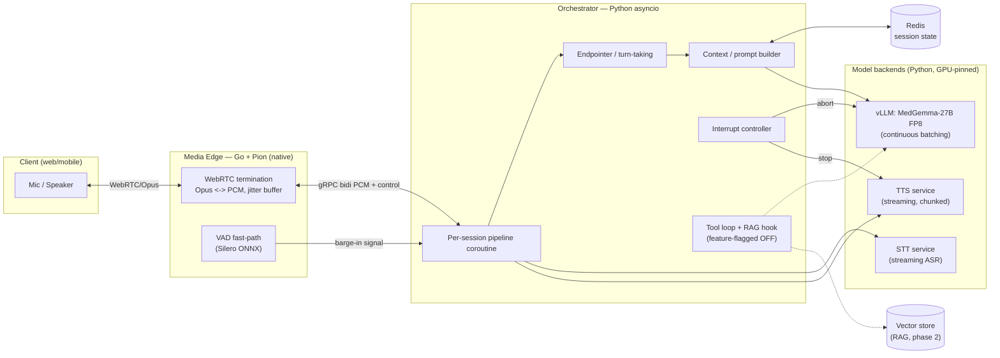
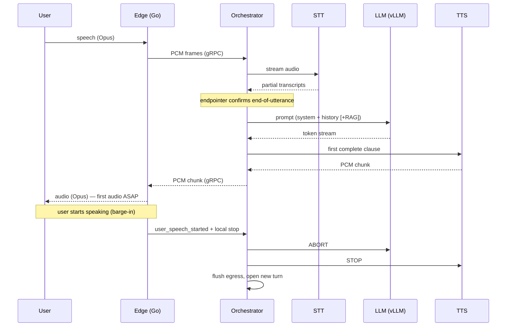

# PRD — Voice Agent Inference Orchestrator

- **Status:** Draft for review
- **Date:** 2026-08-20
- **Owner:** (aarbat@mondee.com)
- **Target hardware:** Single node — 2× NVIDIA L40S (48 GB each), 60 vCPU, 220 GB RAM

> A self-hosted, real-time, full-duplex voice agent. Audio in over WebRTC →
> streaming STT → MedGemma-27B LLM (tool/RAG-capable) → streaming TTS → audio out,
> optimized to squeeze maximum useful work out of 2 GPUs at the lowest achievable
> latency, with barge-in.

---

## 1. Overview

### 1.1 Problem
We need to host a low-latency, conversational voice agent entirely on our own
hardware (no third-party APIs for STT, LLM, or TTS). The agent must feel like a
live phone call: the user speaks, the agent responds by streaming synthesized
speech, and the user can interrupt the agent mid-sentence (**barge-in**). The
scarce resource is GPU; the design's central job is to **orchestrate three model
stages across two GPUs so that GPU, CPU, and RAM are driven to high utilization
without a new request degrading one already in flight.**

### 1.2 What we are building
A program ("the orchestrator") that runs on the node and exposes API endpoints a
client app connects to. It terminates WebRTC media, runs the STT→LLM→TTS pipeline
per session with shared batched model backends, and streams audio back. The base
architecture is fixed across phases; phase 1 is the bare pipeline at least latency,
later phases turn on tools/RAG, deeper observability, and scale-out.

### 1.3 Goals
1. Full-duplex, streaming, barge-in-capable voice conversation over WebRTC.
2. Minimize end-to-end latency (time-to-first-audio and barge-in cut latency).
3. Maximize GPU utilization under concurrency via continuous/dynamic batching.
4. Multi-turn, stateful conversations (server-held history).
5. A stable base architecture that carries from a bare beta to a tool-using,
   RAG-augmented, multi-node system by configuration, not rewrite.

### 1.4 Non-goals (this PRD / phase 1)
- Authentication / authorization / billing (designed-around, not built).
- Multilingual support (English only for phase 1).
- Multi-node horizontal scale (design keeps clean seams; not built in phase 1).
- Tool-calling / RAG **execution** (the layer is built and wired but feature-flagged off).
- Voice cloning / custom per-user voices (single fixed voice in phase 1).

---

## 2. Requirements

### 2.1 Functional
- **F1** Accept WebRTC connections from web/mobile clients; negotiate SDP/ICE.
- **F2** Continuously transcribe inbound audio (streaming STT) with partial results.
- **F3** Detect end-of-utterance (VAD + endpointing) and trigger an LLM turn.
- **F4** Generate a response with MedGemma-27B (FP8), streaming tokens.
- **F5** Synthesize speech from streamed tokens (chunked/streaming TTS) and stream
  audio back to the client with minimal delay.
- **F6** Support **barge-in**: user speech during agent playback immediately stops
  the agent's audio and aborts the in-flight LLM+TTS work, then starts a new turn.
- **F7** Maintain per-session multi-turn conversation history and feed it back to
  the LLM within a managed token budget.
- **F8** Expose a control-plane REST API (session lifecycle, health, metrics) and a
  per-session event WebSocket (partial transcripts, state, interrupt signals).
- **F9** (Built, disabled) A tool-calling/agent-loop + RAG retrieval layer between
  the context builder and the LLM.

### 2.2 Non-functional
- **N1 Latency:** No fixed budget; minimize. Illustrative targets to validate
  (§7): time-to-first-audio ≈ 0.6–1.2 s after the user stops speaking; barge-in
  cut < ~150 ms.
- **N2 Concurrency:** Support 50 concurrent load under **both** interpretations,
  measured and sized in §5:
  - *50 active sessions* (bursty; most idle at any instant) — phase-1 baseline target.
  - *50 simultaneous in-flight generations* (worst case) — met via Topology B.
- **N3 Utilization:** GPU/CPU/RAM driven high under load; admission control prevents
  a new session from degrading in-flight sessions (backpressure, not silent decay).
- **N4 Stability of architecture:** Phase transitions are config/placement changes,
  not re-architecture.
- **N5 Self-hosted:** No external network calls for STT/LLM/TTS.

---

## 3. System Architecture

The system is split into **four planes**, each with a single clear responsibility
and a well-defined interface. Compute lives where the language is strongest:
**native (Go) at the CPU-bound media edge, Python where the ML ecosystem and GPU
engines live.**



### 3.1 Planes
- **Media edge (Go + Pion, native):** Terminates WebRTC, decodes/encodes Opus,
  resamples, runs the jitter buffer, and runs a lightweight **VAD fast-path** on
  decoded PCM. Owns the *fastest* barge-in signal: the instant the user speaks
  during playback, the edge stops emitting TTS frames locally and signals the
  orchestrator. Talks to the orchestrator over **gRPC bidirectional streaming**
  on localhost / Unix-domain socket (raw PCM frames + control events).
- **Control plane (Python, FastAPI):** SDP/ICE signaling, session lifecycle,
  health, metrics, config. Per-session event WebSocket for transcripts/state.
- **Orchestration plane (Python, asyncio):** One cheap coroutine per session wires
  the stages, manages endpointing/turn-taking, builds context, and owns the
  per-session **interrupt controller**. Sessions are lightweight; heavy GPU work
  is funneled into shared batched backends.
- **Model backends (Python, GPU-pinned processes):** vLLM (LLM), STT service, TTS
  service — each a separate process reached over local gRPC/HTTP streaming so it
  can be placed on a specific GPU and batched independently. Localhost RPC adds
  < ~1 ms and buys isolation + independent scaling.

### 3.2 Why this split (rationale, honestly stated)
- **GPU utilization is not a function of the orchestrator language.** Continuous
  batching, paged KV cache, and kernel scheduling happen inside the inference
  engine (vLLM), whose hot path is C++/CUDA. Rewriting orchestration in Go/Rust
  would not improve GPU utilization; writing our own inference would *regress* it
  (no Go/Rust stack matches vLLM/TensorRT-LLM for a 27B FP8 model with continuous
  batching today).
- **The media edge is CPU-bound and latency-critical**, and that is exactly where a
  native language earns its keep (Opus, RTP, jitter buffering for 50 full-duplex
  sessions). Hence Go + Pion — the most battle-tested non-C WebRTC stack (it is
  what LiveKit is built on). See Appendix A for rejected alternatives.

---

## 4. Component Specifications

Each component lists: **responsibility · interface · dependencies.**

### 4.1 Media Edge (Go + Pion)
- **Responsibility:** WebRTC transport; Opus↔PCM (16 kHz mono internal); jitter
  buffer; resampling; VAD fast-path; enforce barge-in locally; multiplex N sessions
  across worker processes pinned to CPU cores.
- **Interface (outward):** WebRTC to client. **Interface (inward):** gRPC bidi
  stream to orchestrator — `AudioFrame{session_id, pcm, ts}` upstream;
  `AudioFrame` (TTS) downstream; `Control{start_turn, user_speech_started,
  stop_playback, session_open/close}`.
- **Dependencies:** Pion (WebRTC), libopus bindings, Silero VAD (ONNX via
  onnxruntime-go), gRPC.

### 4.2 Orchestrator (Python asyncio)
- **Responsibility:** Per-session pipeline; endpointing/turn logic; context build;
  invoke STT/LLM/TTS stream clients; interrupt controller; admission control.
- **Interface:** gRPC to edge; gRPC/HTTP streaming to backends; Redis for state;
  FastAPI control plane + event WebSocket.
- **Dependencies:** FastAPI, grpcio, redis-py, backend client SDKs.
- **Key sub-modules (each independently testable):**
  - `endpointer` — decide end-of-utterance from VAD events + STT stability + a
    silence hangover; emits `start_turn`.
  - `context_builder` — assemble system prompt + token-budgeted history (+ RAG when
    enabled); apply prefix-cache-friendly ordering.
  - `interrupt_controller` — single primitive: on barge-in, atomically abort vLLM
    request + stop TTS stream + flush egress for that session, then open a new turn.
  - `admission_control` — track GPU KV headroom / CPU / RAM; apply backpressure or
    graceful shed when saturated.

### 4.3 LLM Backend (vLLM — MedGemma-27B FP8)
- **Responsibility:** Token generation with continuous batching + prefix caching.
- **Interface:** OpenAI-compatible streaming API + request-abort. Pinned to GPU0
  (Topology A). Prefix caching reuses the shared medical system prompt / RAG KV.
- **Dependencies:** vLLM, FP8 weights of MedGemma-27B, CUDA. TensorRT-LLM is the
  documented drop-in for a later latency squeeze (§9, Appendix A).

### 4.4 STT Backend (streaming ASR)
- **Responsibility:** Low-latency streaming transcription with partials; dynamic
  batching across streams.
- **Interface:** gRPC stream: PCM in → `{partial|final, text, ts}` out. Swappable
  adapter (Faster-Whisper/CTranslate2 or NVIDIA Parakeet-TDT — final choice pending
  accuracy/latency eval). Pinned to GPU1.

### 4.5 TTS Backend (streaming)
- **Responsibility:** Synthesize audio from text chunks with low first-chunk
  latency; stream PCM out; cancellable mid-utterance.
- **Interface:** gRPC stream: text chunk in → PCM frames out. Swappable adapter
  (Kokoro default for fast English; XTTS-v2 if cloning needed later). Pinned to GPU1.

### 4.6 State (Redis)
- **Responsibility:** Per-session conversation history, session metadata, live
  metrics counters. Token-budgeted rolling context window.

### 4.7 Tools / RAG Layer (built, **disabled** in phase 1)
- **Responsibility:** Agent loop for OpenAI-style tool calls; RAG retrieval
  (embedder + vector store + reranker on GPU1 headroom). Sits between
  `context_builder` and the LLM, behind a feature flag.

---

## 5. Capacity Model & GPU Placement

> Numbers below are **engineering estimates to be validated by load tests in
> phase 1** (§8). They establish sizing intent, not guarantees. Gemma-3-27B config
> figures (layers, heads, sliding-window) must be confirmed against the actual
> `config.json` before final tuning.

### 5.1 VRAM budget (per L40S, 48 GB)
- **MedGemma-27B FP8 weights:** ≈ 27 GB.
- **Framework/CUDA overhead:** ≈ 2–3 GB.
- **KV cache pool (remaining):** ≈ 18 GB.
- **KV per token:** with GQA (≈16 KV heads, head_dim 128, ~62 layers) and FP8 KV
  ≈ **0.24 MB/token** naive. Gemma-3's interleaved sliding-window attention (≈5
  local : 1 global) caps KV growth on the local layers beyond the window, so
  effective per-token cost for long contexts is **substantially lower** than naive.
- **Implied KV pool:** ≈ 74k tokens naive on one card (more with SWA). At an
  assumed ~2k-token average live context → **~37 full-context sequences naive**,
  comfortably more with SWA savings.

### 5.2 The two concurrency interpretations
A voice session is bursty: it cycles user-speaking (STT hot, LLM idle) → endpoint
gap → LLM decode → TTS playback (LLM idle) → user listening (all idle). LLM-decode
duty cycle per active session is only a fraction of wall-clock.

- **50 active sessions (bursty) — phase-1 target:** typically ~10–20 concurrent
  decodes at any instant. **One FP8 replica on GPU0 handles this** with continuous
  batching; KV pool sufficient. → **Topology A.**
- **50 simultaneous in-flight decodes (worst case):** ~24 GB naive KV at 2k context
  exceeds one card's ~18 GB and pushes per-token latency up at large batch. →
  **Topology B** (second replica) roughly doubles KV pool + compute.

### 5.3 Topology A — baseline (phase 1)
```
GPU0 (48GB): MedGemma-27B FP8  → 27GB weights + ~18GB KV   [all LLM traffic]
GPU1 (48GB): STT + TTS + VAD    → ~12GB + ~34GB headroom     [+ RAG helpers later]
```
- No cross-GPU tensor parallelism → no PCIe all-reduce tax per token (critical:
  **L40S has no NVLink**; the two GPUs share only PCIe Gen4 x16 ≈ 64 GB/s).
- Clean isolation: STT/TTS bursts cannot starve the LLM, and vice-versa.

### 5.4 Topology B — config upgrade (same architecture)
- Spin a **second FP8 LLM replica on GPU1**; relocate STT/TTS to GPU1's remainder
  or CPU-offload the RAG helpers; load-balance the two LLM replicas.
- Because both stages already sit behind an internal service boundary, this is a
  **config/placement flip**, honoring "base architecture stays the same."
- **Rejected: tensor-parallel (TP=2)** — worse token throughput and TTFT on this
  no-NVLink box (all-reduce over PCIe, not NVLink), and it forces STT/TTS to
  timeshare the same silicon. See Appendix A.

### 5.5 CPU / RAM allocation (60 vCPU, 220 GB)
- **vCPU:** partitioned into (a) Go media-edge workers (WebRTC/Opus/resample/VAD —
  the heaviest CPU consumer, scaled across cores), (b) Python orchestrator event
  loops, (c) backend pre/post-processing. Media work is process-parallel to avoid
  any single-runtime contention.
- **RAM:** audio/jitter buffers, prefix-cache overflow, Redis, warm model
  artifacts, headroom for RAG index (phase 2).

---

## 6. Data Flow, Latency Strategy & Barge-in

### 6.1 Turn sequence


### 6.2 Latency strategy (why it's low)
Stream at every stage and **overlap** them: STT emits partials live; the LLM starts
the instant the endpointer fires; **TTS starts on the first complete clause**, not
the full reply; prefix caching keeps the medical system prompt / RAG KV warm so
prefill is cheap.

Illustrative time-to-first-audio (to validate): endpoint-detect ~250–400 ms →
final STT ~50–150 ms → LLM prefill+TTFT ~100–400 ms → first TTS chunk ~100–250 ms →
edge encode+net ~20–60 ms ⇒ **≈ 0.6–1.2 s total.**

### 6.3 Barge-in semantics (first-class)
The edge VAD fast-path detects user speech during playback and **immediately stops
emitting TTS frames locally** (cutting perceived audio in < ~150 ms), then signals
the orchestrator, whose `interrupt_controller` **atomically** aborts the in-flight
vLLM request, stops the TTS stream, and flushes egress before opening a new turn.
Per-session cancellation is a core primitive, not an afterthought.

**Barge-in cancels generation, never recognition.** ASR is the one stage that is
never interrupted: everything the user says is transcribed and persisted, whether
or not the agent ever answers it. Only the LLM and TTS stages of the superseded
turn are aborted, because the user has stopped caring what the agent was about to
say — not what they themselves just said. Two rules follow:

- **Ingestion is never blocked by inference.** The STT reader hands finalized
  utterances to a separate turn runner and returns immediately. If it awaited the
  turn, nothing would drain STT's response stream; gRPC flow control would back up
  into the ASR, whose bounded segment queue would overflow and stop accepting
  audio — losing user speech before it was ever transcribed.
- **A superseded turn is recorded, not answered.** If a newer utterance has begun
  (or the user is still mid-sentence) by the time a transcript is ready, that turn
  is persisted to Redis and kept in the prompt history, but no LLM or TTS work is
  spent on it. Because the chat contract requires alternating USER/ASSISTANT
  pairs, an unanswered utterance is merged into the next user message rather than
  dropped — so the model always sees every word the user spoke.

---

## 7. Concurrency, Batching & Admission Control
- **LLM:** continuous batching (vLLM) merges all active decodes into batched passes
  → high GPU utilization automatically. Prefix caching shares system-prompt/RAG KV.
- **STT/TTS:** dynamic batching across streams.
- **Admission control + backpressure:** a scheduler tracks GPU KV headroom / CPU /
  RAM; when saturated it queues or gracefully sheds with an explicit client signal —
  **never** lets a new session silently degrade in-flight ones (N3).
- **Session caps:** configurable max concurrent sessions per topology, derived from
  the validated capacity model (§5).

---

## 8. Interfaces & Contracts

### 8.1 External API (phase-1, no auth)
- `POST /v1/sessions` → `{session_id, ice_servers, ...}`.
- WebRTC signaling endpoint (SDP offer/answer, ICE).
- `WS /v1/sessions/{id}/events` → partial transcripts, agent state, barge-in events.
- `DELETE /v1/sessions/{id}` → teardown.
- `GET /healthz`, `GET /metrics` (Prometheus).
- Auth middleware is a designed-in slot (deferred).

### 8.2 Edge ↔ Orchestrator (gRPC bidi streaming, localhost/UDS)
- Upstream: `AudioFrame{session_id, pcm16, ts}`.
- Downstream: `AudioFrame` (TTS PCM).
- Control (both ways): `session_open/close`, `user_speech_started`,
  `stop_playback`, `start_turn`.

### 8.3 Orchestrator ↔ Backends
- LLM: OpenAI-compatible streaming + abort.
- STT/TTS: gRPC streaming with cancellation.

---

## 9. Tech Stack

| Plane | Choice | Notes |
|---|---|---|
| Media edge | **Go + Pion**, libopus, Silero VAD (ONNX), gRPC | CPU-bound, native, most-mature non-C WebRTC |
| Control plane | **Python + FastAPI** | signaling, lifecycle, health, metrics |
| Orchestration | **Python + asyncio**, grpcio | I/O-bound per-session pipelines |
| LLM | **vLLM**, MedGemma-27B **FP8** | continuous batching + prefix cache; TensorRT-LLM = later latency squeeze |
| STT | Faster-Whisper (CT2) **or** Parakeet-TDT | swappable adapter; final pick via eval |
| TTS | Kokoro (default) **or** XTTS-v2 | swappable adapter; cloning later |
| State | **Redis** | session history, metadata, metrics |
| Vector store (P2) | (TBD: Qdrant/pgvector/FAISS) | RAG, GPU1 headroom |
| Deploy | **Docker Compose** + NVIDIA Container Toolkit | GPU pinning via `CUDA_VISIBLE_DEVICES` |
| Observability | Prometheus + Grafana, OpenTelemetry hooks | per-stage latency (TTFT, first-audio, RTF) |

---

## 10. Deployment & Configuration
- Single node; each backend a container pinned to a GPU via `CUDA_VISIBLE_DEVICES`.
- Topology A/B selected by config (replica placement) — no code change.
- Feature flags: `tools_enabled`, `rag_enabled` (both false in phase 1).
- Designed to lift to Kubernetes later (stateless services + external Redis).

---

## 11. Observability
Per-stage metrics: endpoint-detect time, STT final latency, LLM TTFT + tokens/s,
TTS first-chunk latency, time-to-first-audio, barge-in cut latency, concurrent
sessions, GPU KV utilization, CPU/RAM. Structured logs + OpenTelemetry traces
across the edge→orchestrator→backend path. Deep dashboards land in phase 2; the
metric hooks exist from phase 1 for capacity validation.

---

## 12. Phased Roadmap
- **Phase 1 — Beta (bare pipeline, least latency):** Topology A; Go edge; Python
  orchestrator; vLLM FP8 LLM; streaming STT + TTS; full-duplex + barge-in;
  multi-turn state; minimal metrics; **capacity/latency benchmarks** to validate §5/§6.
- **Phase 2 — Capability:** enable tools/RAG; deeper observability dashboards;
  accuracy-eval gate for FP8 (§13).
- **Phase 3 — Scale/perf:** Topology B if load-bound; TensorRT-LLM evaluation;
  native media hardening; multi-node lift; auth.

---

## 13. Risks & Mitigations
- **R1 — Go edge CPU ceiling at 50 full-duplex sessions.** *Mitigation:* process-
  parallel media workers across 60 vCPU; edge behind gRPC seam so it can be sharded
  or hardened; load-test early.
- **R2 — FP8 medical accuracy.** *Mitigation:* accuracy-eval gate before committing
  FP8 to production; fall back to higher precision or Topology B/TP only if the gate
  fails. **Do not assume FP8 is lossless for clinical text without measuring.**
- **R3 — KV-cache limits under "50 simultaneous."** *Mitigation:* validated capacity
  model; Topology B; context-window budgeting; prefix-cache reuse.
- **R4 — Barge-in correctness (races between abort/flush/new-turn).** *Mitigation:*
  single interrupt-controller primitive; dedicated correctness test harness.
- **R5 — Cold starts / model load.** *Mitigation:* keep models resident; warm-up on boot.
- **R6 — Capacity numbers are estimates.** *Mitigation:* §5 is explicitly gated on
  phase-1 benchmarks before capacity claims are made externally.

---

## 14. Success Metrics / Acceptance (phase 1)
- Working full-duplex conversation over WebRTC with barge-in.
- Measured time-to-first-audio and barge-in cut latency reported against §6 targets.
- Demonstrated concurrent-session capacity under both interpretations, with the
  crossover point where Topology B becomes necessary identified.
- STT accuracy (WER) and end-to-end reliability characterized on representative
  medical English audio.

---

## Appendix A — Rejected Alternatives (with reasons)
- **Tensor-parallel LLM (TP=2) as baseline** — rejected: no NVLink on L40S, so
  per-token all-reduce runs over PCIe (~64 GB/s), lowering throughput/TTFT, and it
  forces STT/TTS to timeshare the GPUs. Kept only as a fallback if FP8 accuracy
  fails R2.
- **Rewriting orchestration/inference in Go/Rust for "GPU optimization"** — rejected:
  GPU batching lives in the engine's C++/CUDA core, not the orchestrator; a rewrite
  yields ~0 GPU gain and a custom inference stack would regress vs vLLM/TensorRT-LLM.
- **Framework substrate (Pipecat / LiveKit Agents)** — not adopted per decision to
  hand-roll; native Go edge + Python orchestrator chosen for control and to keep the
  low-level media plane where a native language actually helps.
- **All-Python media edge (aiortc)** — rejected for the target load: pure-Python
  Opus/RTP/jitter handling is a CPU/tail-latency risk at 50 full-duplex sessions.

## Appendix B — Open Questions
- Final STT and TTS model selection (pending latency/accuracy eval).
- Exact Gemma-3-27B config values to confirm KV math.
- Vector store choice for phase-2 RAG.
- Fixed TTS voice identity for phase 1.
