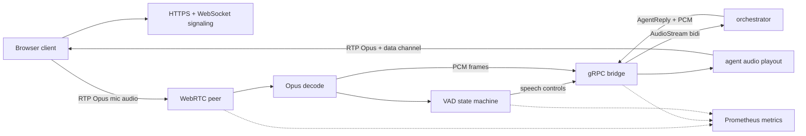

# Media Edge Service

`media-edge` is the browser-facing gateway for the voice pipeline. It serves
the test client, terminates WebRTC, decodes microphone Opus frames to 16 kHz
mono PCM, detects speech activity, streams audio/control events to the
orchestrator, and plays synthesized agent audio back to the browser.

Setup and run instructions live in [SETUP.md](SETUP.md).

## Responsibilities

- Serve the browser client over HTTPS for microphone access.
- Handle WebRTC signaling, ICE, RTP, and Opus audio.
- Decode user audio into the PCM format expected by the orchestrator.
- Run Silero ONNX VAD when available, with RMS fallback.
- Emit barge-in and endpointer controls from one VAD state machine.
- Relay orchestrator text and audio replies to the browser.
- Buffer outbound agent audio and emit `utterance_end` after drain.
- Expose edge health and media-path metrics.
- Optionally stream both audio timelines to the avatar service and send its
  video back on a lip-synced WebRTC track (see [avatar](../avatar/README.md)).

## Architecture



The edge owns real-time browser transport and packet handling. It does not own
conversation state, transcripts, LLM requests, or persistent telemetry. Those
belong to the orchestrator and downstream services.

## VAD Model

The service uses one speech state machine for both neural and energy VAD. When
Silero ONNX and ONNX Runtime are available, the state machine consumes Silero
speech probabilities. If ONNX Runtime or the model is missing, the service
falls back to an RMS energy signal.

This lets development builds run without native ONNX dependencies while keeping
the production path on neural VAD.

## Playback Semantics

The orchestrator sends `AGENT_TURN_ENDED` when it has queued the final output
for a turn. The edge treats that as a drain marker, waits until buffered agent
audio has been emitted, then sends `utterance_end` to the browser over the
`agent-events` data channel. This tag means the agent will not send more audio
or text for that `turn_id` until the next user question starts a new turn.
Barge-in flushes the playout buffer and emits `utterance_end` with
`reason: "interrupted"`.

For compatibility, the edge also emits the older `playback_complete` event with
the same `session_id`, `turn_id`, and `reason` fields.

## Layout

```text
media-edge/
  cmd/media-edge/    Main service, WebRTC, bridge, VAD, metrics, playout
  internal/certs/    Development certificate generation
  internal/edgepb/   Generated Go gRPC bindings
  internal/profile/  Browser/media profile parsing
  internal/silero/   Vendored Silero ONNX wrapper
  models/            VAD model artifacts
  run.sh             Environment-aware launcher
  setup_ubuntu.sh    Ubuntu setup helper
```
