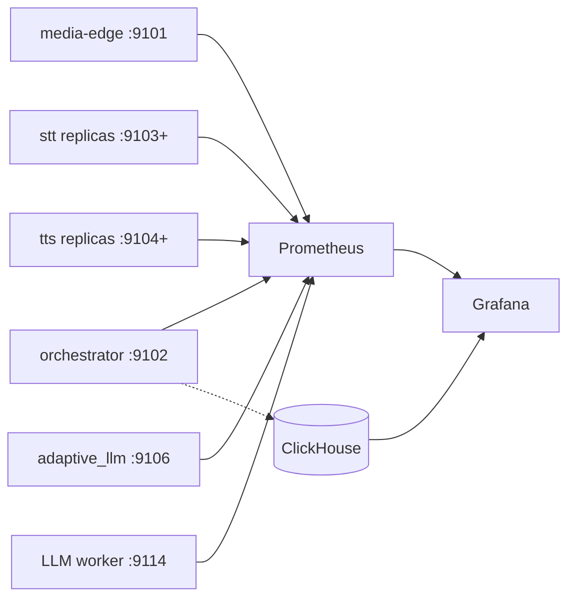

# Monitoring

`monitoring` contains the observability stack for the inference pipeline:
Prometheus scrape configuration, alert rules, ClickHouse schema/migrations, and
Grafana dashboards.

Setup and run instructions live in [SETUP.md](SETUP.md).

## Responsibilities

- Scrape service health and saturation metrics from Prometheus endpoints.
- Store per-session pipeline events and summaries in ClickHouse.
- Provision Grafana data sources and dashboards for local development.
- Track bounded overload behavior, backend capacity, and caller-felt latency.
- Keep telemetry separate from Redis session state.

## Architecture



Prometheus tracks live service health, queues, saturation, and error rates.
ClickHouse stores ordered traces and closed-session summaries emitted by the
orchestrator. Grafana combines both sources.

## Metrics Model

Metrics are chosen to explain user-visible symptoms and known bottlenecks:

| Area | Leading signals |
| --- | --- |
| Edge ingress | Active sessions, session starts, VAD events, Opus/VAD/gRPC errors, playout stalls. |
| Orchestration | Active sessions, queue depth, turn controls, dropped frames, STT stream errors, transcript counts. |
| STT | Queue wait, real-time factor, window length, compute time, in-flight work, model errors. |
| LLM | Active and queued requests, queue time, available RAM/VRAM, worker latency, generated replies. |
| TTS | Synthesis count, synthesis latency, worker wait, rejected requests, pool wait, errors. |

The most important capacity indicators are STT queue wait, STT real-time
factor, orchestrator STT queue depth, LLM queue depth, TTS queue wait, and
turn-level rejection rates.

## ClickHouse Telemetry

The orchestrator writes `pipeline.pipeline_events` during sessions and
`pipeline.session_summaries` after close. Events include typed model, engine,
device, version, latency, and queue fields so dashboards can compare releases
without parsing free-form JSON.

Intermediate STT segment text is not copied to ClickHouse. Final transcript and
assistant reply text can appear in restricted session-detail views, so dashboard
access should match the sensitivity of conversation data.

## Dashboards

Grafana dashboard definitions live under [grafana/dashboards](grafana/dashboards):

| Dashboard | Purpose |
| --- | --- |
| Voice Agent KPIs | Daily fleet view: time-to-first-audio, answer rate, barge-ins, error rate, and slowest turns. |
| Inference Session Detail | One-session drilldown with turn timeline, latency breakdown, conversation, and raw audit trace. |
| Model & Release Deep-Dive | Per-model, per-engine, per-device, and per-version comparisons. |
| Saturation & Bounded Overload | Prometheus view of offered load, admitted work, rejections, queue depth, and resource saturation. |

Caller-felt latency is time from endpointing to first agent PCM queued to
media-edge. LLM decode and TTS synthesis can overlap playback, so dashboard
queries do not stack those worker durations into a fake end-to-end total.

## Layout

```text
monitoring/
  prometheus.yml       Prometheus scrape config
  alerts.yml           Alert rules
  targets/             File-discovery targets written by scripts/run_pipeline.py
  clickhouse/          Schema and telemetry migrations
  grafana/             Dashboards and provisioning config
```
