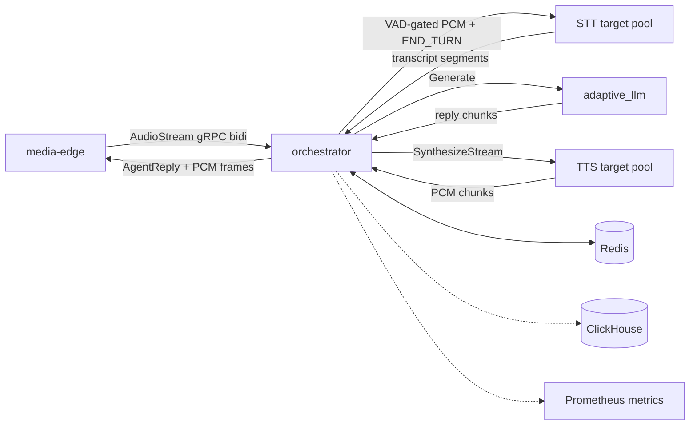

# Orchestrator Service

`orchestrator` is the real-time pipeline hub. It receives decoded audio and
control events from media-edge, assembles user turns, routes audio to STT,
sends completed turns to the adaptive LLM, streams LLM clauses through TTS, and
returns text plus PCM audio to the edge.

Setup and run instructions live in [SETUP.md](SETUP.md).

## Responsibilities

- Own the lifecycle of each voice session.
- Gate STT input using edge VAD events while preserving pre-roll audio.
- Join immutable STT segments into completed user turns.
- Load bounded conversation history from Redis for LLM context.
- Route LLM output into streamed TTS synthesis.
- Cancel active LLM/TTS work on barge-in.
- Emit turn lifecycle signals and telemetry without blocking the media path.
- Fan out across multiple STT and TTS replicas when configured.

## Architecture



The orchestrator is intentionally model-agnostic. It talks to STT, LLM, and TTS
through stable gRPC contracts generated under `orchestrator/proto/`. Backend
model selection, GPU placement, and runtime compatibility checks stay inside
the downstream services.

## Turn Ownership

The orchestrator is the authority for agent turn state. It emits
`AGENT_TURN_STARTED` when a reply has been accepted for processing and
`AGENT_TURN_ENDED` on every exit path: success, interruption, or error. The
edge holds the end signal until audio playback drains, then tells the browser
`PLAYBACK_COMPLETE`.

Every downstream message carries a `turn_id`. That keeps late output from an
interrupted turn from crossing into the next user turn.

## State Boundaries

Redis stores recoverable logical state: session metadata, bounded event streams,
active-turn coordination, and completed user/assistant turns. Live audio
buffers, gRPC streams, WebRTC state, and model request handles remain in
process memory.

ClickHouse receives append-only session telemetry through a background writer.
Telemetry is allowed to drop under pressure; Redis state is not.

## Layout

```text
orchestrator/
  service/       Routing, session store, telemetry, and audio helpers
  proto/         Generated Python gRPC bindings
  tests/         Unit and routing checks
  run.sh         Environment-aware launcher
  server.py      Compatibility launcher for service/server.py
```
