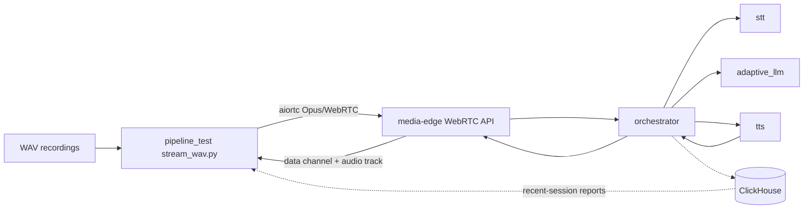

# Pipeline Test Harness

`pipeline_test` is a WAV-based end-to-end harness for the real voice pipeline.
It drives the media-edge WebRTC API directly with `aiortc`, so developers can
test the browser path without launching Chromium or using a microphone.

Setup and run instructions live in [SETUP.md](SETUP.md).

## Responsibilities

- Replay local WAV recordings as sequential user turns.
- Establish a real WebRTC session with media-edge.
- Send Opus/RTP audio through the same ingress path as the browser.
- Receive agent reply events on the data channel.
- Drain returned agent audio before sending the next turn.
- Produce local result files for test runs.
- Query recent ClickHouse session summaries for aggregate performance reports.

## Architecture



The harness does not replace service-level tests. It validates the integrated
media, turn-taking, STT, LLM, TTS, and playback flow through the public edge
interface.

## Test Model

All selected recordings run as sequential turns in one persistent session. This
preserves server-held conversation history, matching the browser experience
more closely than independent one-shot requests.

The ClickHouse reporting tool reads aggregate timing and funnel data from
recent closed sessions. It avoids printing session IDs, transcripts, replies, or
raw event rows.

## Layout

```text
pipeline_test/
  stream_wav.py              WAV-to-WebRTC end-to-end runner
  report_recent_sessions.py  Recent closed-session aggregate report
  load_burst.py              Bounded overload/load generator
  open_loop_load.py          Open-loop load generator
  recordings/                Local WAV inputs
  requirements.txt           Harness dependencies
```
