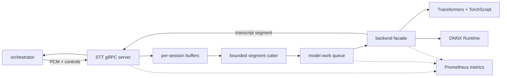

# Speech-to-Text Service

`stt` hosts SraVaani speech recognition behind the `asr.v1.Asr/Stream`
bidirectional gRPC API. It receives VAD-gated 16 kHz mono PCM from the
orchestrator and returns ordered transcript segments, including final segments
that complete user turns.

Setup and run instructions live in [SETUP.md](SETUP.md).

## Responsibilities

- Accept streaming PCM audio and control events from the orchestrator.
- Maintain per-session audio buffers.
- Cut long speech into bounded immutable segments near quiet points.
- Finalize a user turn when the orchestrator forwards `END_TURN`.
- Run SraVaani through the selected backend: Transformers/TorchScript or ONNX.
- Bound concurrent model work with queue and in-flight limits.
- Expose latency, queue, RTF, and error metrics.

## Architecture



The service boundary is model-neutral. The orchestrator does not know whether
the active STT runtime is TorchScript/Transformers or ONNX, and the STT service
does not own turn history or LLM context.

## Segment Model

SraVaani is batch-oriented, so the service treats streaming as a sequence of
bounded batch transcriptions. It cuts long audio windows at quiet points when
possible, emits immutable segments, and resets the window on turn completion.
This keeps worst-case compute bounded for long user speech.

## Runtime Model

The default runtime is SraVaani TorchScript through Transformers. The ONNX
runtime can run INT8, FP8, or FP16 variants and can select CPU or CUDA providers.
Both paths share the same gRPC contract and segment lifecycle.

## Layout

```text
stt/
  service/       gRPC server, segment logic, backend facade
  service/backends/
                 Transformers and ONNX backend implementations
  scripts/       Profiling, backend benchmark, and concurrency tools
  tests/         Segment and service checks
  docs/          Runtime notes, plans, and benchmark reports
  models/        Local model artifacts
  proto/         Generated Python gRPC bindings
  run.sh         Environment-aware launcher
  server.py      Compatibility launcher for service/server.py
```
