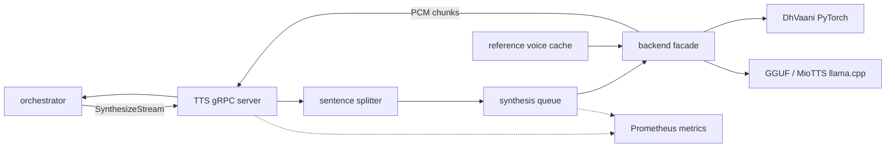

# Text-to-Speech Service

`tts` turns assistant text into speech for the voice pipeline. It exposes
`tts.v1.Tts/Synthesize` and `SynthesizeStream` over gRPC, receives reply text
from the orchestrator, and returns mono PCM16 audio at the model's native
sample rate.

Setup and run instructions live in [SETUP.md](SETUP.md).

## Responsibilities

- Load one configured TTS model at startup.
- Cache one reference voice prompt and its conditioning features.
- Synthesize assistant replies from text supplied by the orchestrator.
- Stream completed sentence audio chunks as soon as they are ready.
- Bound text size, queue depth, queue wait, and worker execution.
- Report queue, synthesis, and error metrics.

## Architecture



The orchestrator owns reply text, cancellation, and turn lifecycle. TTS owns
model loading, speaker conditioning, synthesis scheduling, and PCM generation.

## Streaming Model

DhVaani is not token-streamable at the phoneme level. The service therefore
streams at sentence boundaries: the orchestrator feeds LLM clauses, TTS renders
each complete sentence, and the orchestrator relays PCM frames to media-edge as
they arrive.

The unary `Synthesize` API remains available for test clients and legacy
callers.

## Voice Boundary

The service exposes one configured voice. The reference WAV and transcript are
loaded during startup and are not selected per request. Callers provide only the
assistant reply text.

## Layout

```text
tts/
  service/          gRPC server, runtime, and backend facade
  service/backends/ PyTorch and llama.cpp backend implementations
  proto/            Generated Python gRPC bindings
  tests/            Backend checks and gRPC smoke client
  sample/           Checked-in audio fixtures
  models/           Local model artifacts
  run.sh            Environment-aware launcher
  server.py         Compatibility launcher for service/server.py
```
